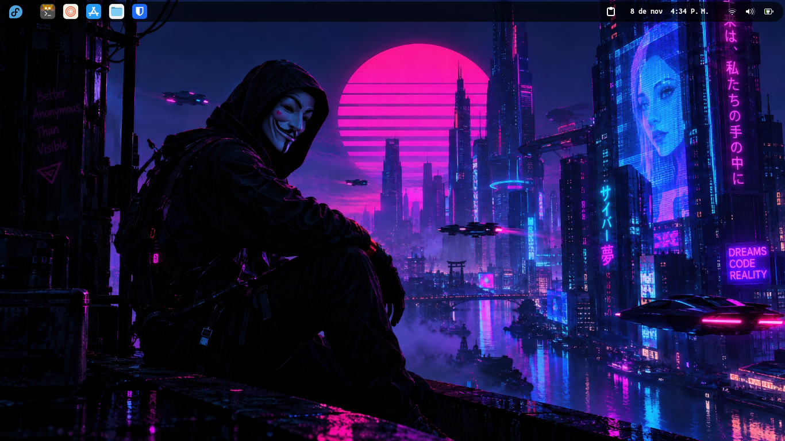
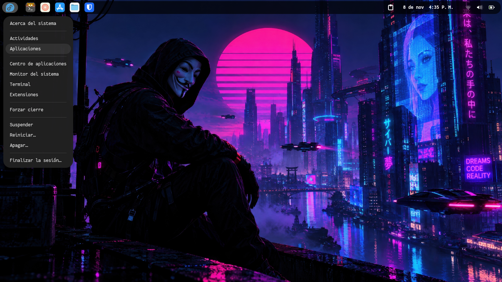
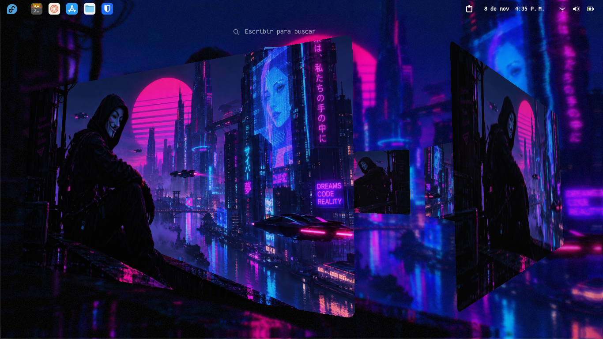
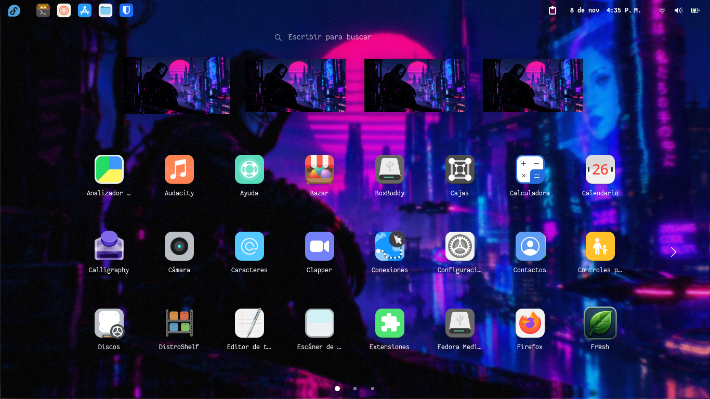
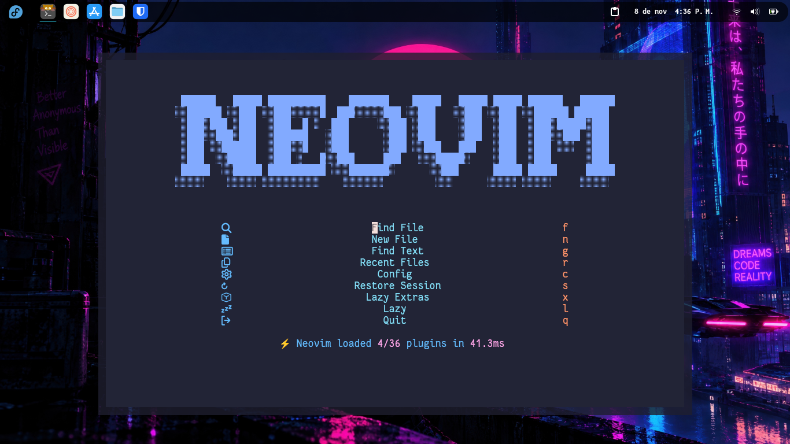
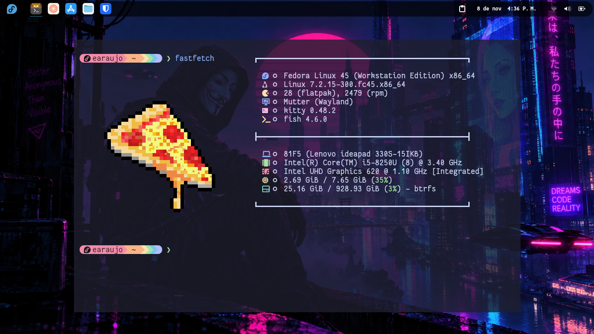

# Configuraciones









## INSTRUCCIONES

- Clonamos la carpeta una vez instalamos los programas requeridos

```
git clone <URL Repo>
```

- Copiamos o reemplazamos las carpetas necesarias en el apartado .config

```
~/.config/
```

- Descargar la fuente de la terminal de Nerds Fonts: <https://www.nerdfonts.com/font-downloads>

- Instalamos Starship: <https://starship.rs/guide/>

```
curl -sS https://starship.rs/install.sh | sh
```

- Instalamos Kitty como terminal predeterminada: <https://sw.kovidgoyal.net/kitty/>

Ubuntu/Debian:

```
sudo apt install kitty
```

Fedora/Red Hat:

```
sudo dnf install kitty
```

- Instalamos Fish Shell: <https://fishshell.com/>

Ubuntu/Debian:

```
sudo apt install fish
```

Fedora/Red Hat:

```
sudo dnf install fish
```

- Instalamos Neovim como editor

Ubuntu/Debian:

```
sudo apt install neovim
```

Fedora/Red Hat:

```
sudo dnf install neovim
```



- Generar un archivo de configuracion para Fastfetch

```
fastfetch --gen--config
```



- Para la personalización del entorno se utilizan extensiones de Gnome:

- <https://github.com/aunetx/blur-my-shell>
- <https://github.com/hermes83/compiz-alike-magic-lamp-effect>
- <https://github.com/boerdereinar/copyous>
- <https://github.com/fthx/dash-in-panel>
- <https://github.com/Schneegans/Desktop-Cube>
- <https://github.com/Aryan20/Logomenu>

- Usertheme para aplicar los temas con Gnome-Extensions
